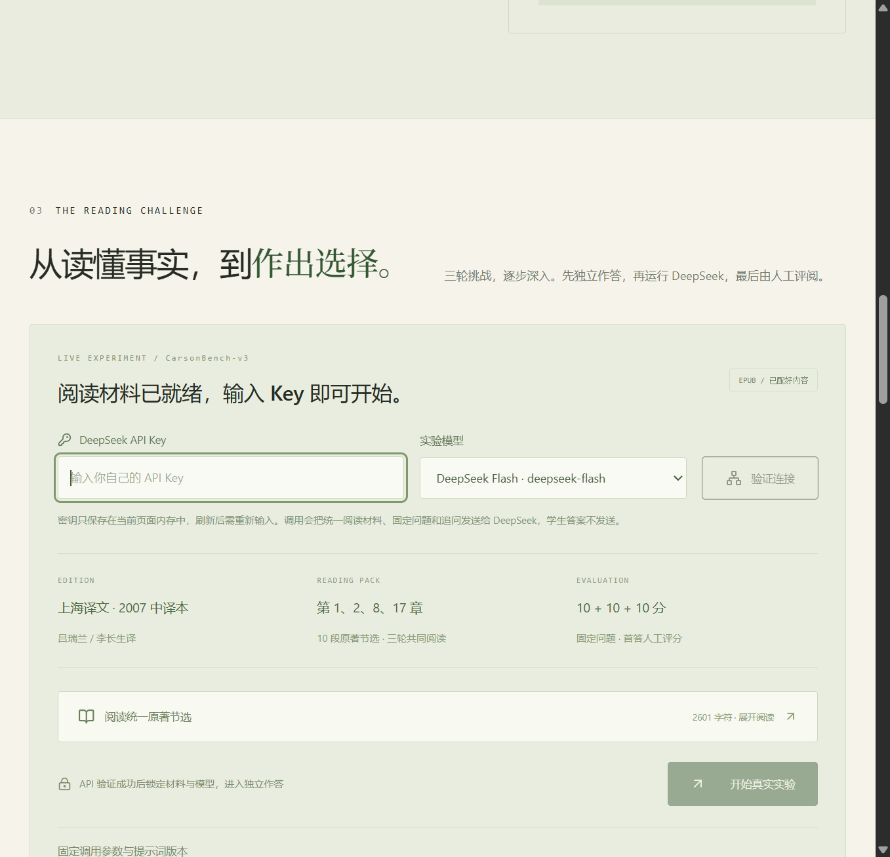

# CarsonBench
# 习概课堂作业
**当 DeepSeek 遇见卡森：基于《寂静的春天》的真实人机阅读实验。**

桌面课堂展示与实际模型实验使用同一个页面。输入自己的 DeepSeek API Key、选择模型，点击「开始真实实验」，即可进入阅读、独立作答、模型调用、人工评分、比较结论的完整流程。



## 本地运行

需要 Node.js 22.12+。

```sh
npm install
npm run dev
```

打开终端显示的地址。`npm run build` 构建；`npm run preview` 提供生产预览及同源 API 代理；`npm test` 检查评分、阅读包、API 边界和实验档案。

技术栈：React、Vite、Tailwind CSS、Framer Motion。API 代理使用 Node 标准 `fetch`，无需数据库和额外服务框架。API 功能须使用上述服务或 Vercel，不能仅双击 HTML 或只托管静态文件。

## 阅读材料已准备好

- 根据用户提供的 EPUB 核对：上海译文出版社，2007-11；吕瑞兰、李长生译；ISBN 9787532742189。
- 固定阅读包 `CB-READING-1`：第 1、2、8、17 章共 10 段原文，含来源标识和章节段落编号。三轮学生与模型看到完全相同的阅读材料与共同作答要求。
- 17 章原创导读连接寓言、生态关系、公共责任和另一条道路。导读不是原著引文，也不代替原著。
- 三轮固定问题：事实理解、文学隐喻、四周校园生态行动。每轮提供证据定位和评分细则；不预填学生答案或模型回答。
- 章节段号按此 EPUB 的正文 `p` 元素顺序，跳过装饰分隔符，不等同印刷页码。原始 EPUB 和完整提取文件不发布。

## 完整实验流程

1. 在「三关挑战」输入自己的 Key、选择模型，点击「开始真实实验」。平台读取账户模型列表、验证连接并锁定阅读包和模型。「验证连接」也可单独刷新账户的可用模型列表。
2. 展开固定原著节选，学生独立作答，再点击「运行 DeepSeek 实验」。学生答案保存为快照，**不发送给模型**。
3. 模型返回后保存首答、完整请求和原始响应、返回的模型标识、时间、Token 用量与结束原因。学生答案锁定，按同一量表人工评分。
4. 每轮可追问最多四次。追问使用该轮首答和已有追问上下文，单独归档，不替换首答或改变评分。
5. 「重开本轮」可以修改学生答案并重新调用。旧首答、评分及追问仍保存在完整档案里。
6. 完成双方三轮评分后生成比较结论，下载完整 JSON。开始新实验前会自动下载上一份记录备份。

每轮等权 10 分，总计 30 分。第三轮可行性、证据、生态各 10 分，合计后除以 3。雷达图按各维度满分归一化；证据轴为三轮证据得分比例均值。观众选择和追问不计入首答评分。模型的历史训练记忆、学生阅读背景和评分人的判断并未被实验消除；单次结果不能推断所有人或模型的能力。

## 密钥、用量与数据

- Key 只保存在当前页面内存，不进入 localStorage、源码、实验导出或 GitHub。刷新后需重新输入。
- 同源 Node 代理只转发到 `https://api.deepseek.com`，不使用共享服务器密钥。每位使用者提供自己的 Key。
- 连接验证调用 `/models`；生成与追问调用 `/chat/completions`，按账户实际用量计费。不自动重试。取消或超时不保证已发送的请求免于计费。
- 参数固定为 `temperature: 0`、`max_tokens: 4096`、非流式、思考模式关闭；提示词 `CarsonBench-v3`。
- 模型别名可能随供应商升级，服务端返回标识未必表示可复现的底层权重版本。每次调用保留完整原始响应，固定参数也不保证完全确定性。
- 阅读材料、学生回答和实验档案保存在当前浏览器，不跨设备同步；使用 JSON 下载备份。本版本不提供 JSON 导入。

## 部署到 Vercel

使用 Vite preset，构建命令 `npm run build`，输出目录 `dist`。`api/deepseek/chat.js` 与 `api/deepseek/models.js` 是同源 Node 函数，不需要配置公共服务 Key。部署时确认函数执行时限满足模型响应时间。纯静态托管需要额外接入 Node 代理。

## 许可与来源

原创代码、界面和导读使用 [MIT](LICENSE)。原著、中译文节选与照片各自保留原有权利，见 [第三方内容说明](THIRD_PARTY_NOTICES.md)。MIT 不为这些第三方内容提供额外授权。

- [DeepSeek 官方首次调用](https://api-docs.deepseek.com/zh-cn/)、[模型列表](https://api-docs.deepseek.com/zh-cn/api/list-models/)、[思考模式](https://api-docs.deepseek.com/zh-cn/guides/thinking_mode/)。
- 肖像：USFWS；[Wikimedia Commons 文件页](https://commons.wikimedia.org/wiki/File:Rachel-Carson.jpg)。
- [美国化学会：Silent Spring 历史资料](https://www.acs.org/education/whatischemistry/landmarks/rachel-carson-silent-spring.html)。
